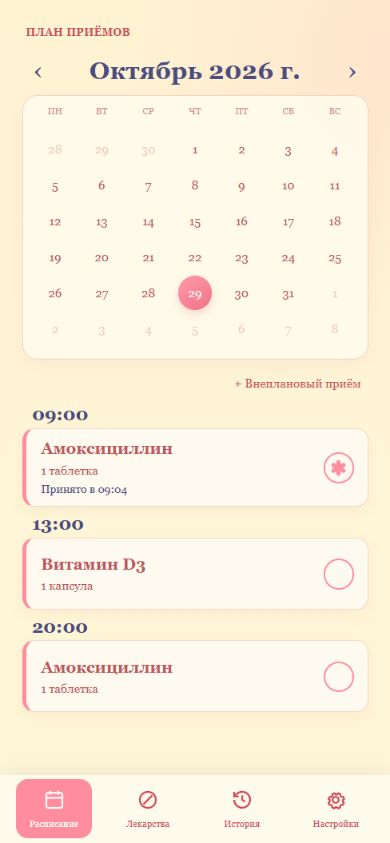
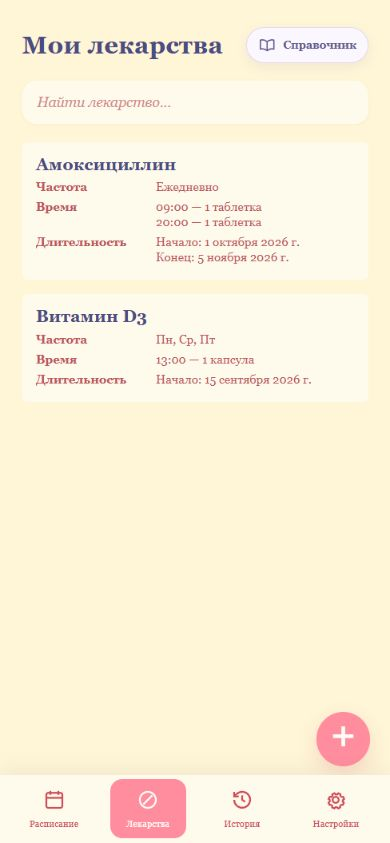
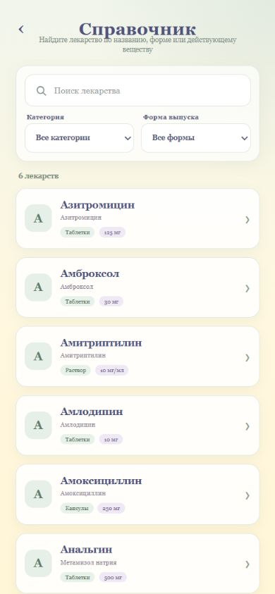
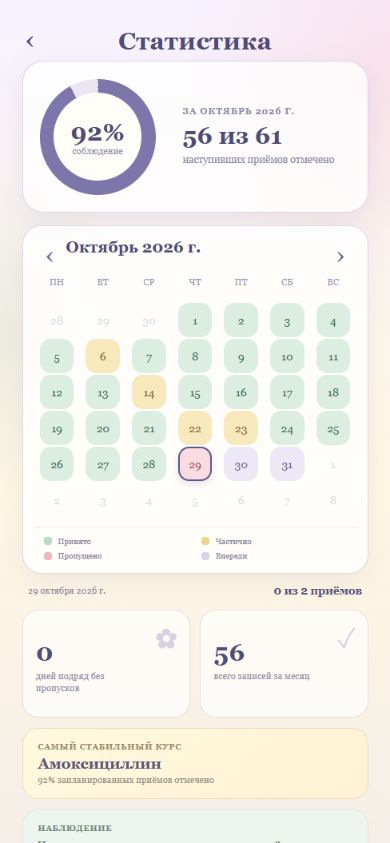
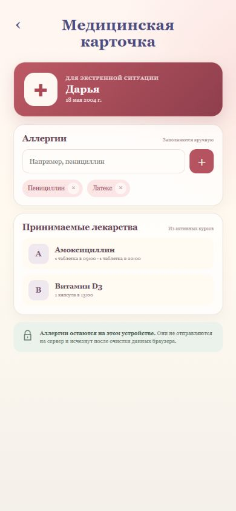
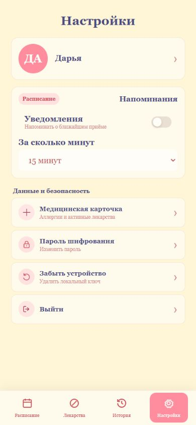

<div align="center">

# Моя аптечка

Веб-приложение (на данный момент) для курсов лекарств, расписания и истории приёмов.

[**Запустить локально**](docs/local-setup.md) · [Документация](docs/README.md) · [API](docs/backend/api.md)

</div>

## Возможности

- курсы с несколькими дозами, временем и днями недели;
- календарь плановых и внеплановых приёмов;
- история, статистика соблюдения курса и серии без пропусков;
- справочник из 100 (пока что) препаратов с поиском и фильтрами;
- локальный учёт остатка лекарства и медицинская карточка с аллергиями;
- вход по коду из письма, обновляемая сессия и клиентское шифрование.

## Интерфейс

<table>
  <tr>
    <th>Расписание</th>
    <th>Мои лекарства</th>
    <th>Справочник</th>
  </tr>
  <tr>
    <td></td>
    <td></td>
    <td></td>
  </tr>
  <tr>
    <th>Статистика</th>
    <th>Медицинская карточка</th>
    <th>Настройки</th>
  </tr>
  <tr>
    <td></td>
    <td></td>
    <td></td>
  </tr>
</table>

## Технологии

`Vue 3` · `Vite` · `FastAPI` · `SQLAlchemy` · `PostgreSQL`

## Быстрые ссылки

- [Полная настройка и локальный запуск](docs/local-setup.md)
- [Настройки backend — `.env.example`](server/.env.example)
- [Настройки frontend — `.env.example`](frontend/.env.example)
- [Настройка backend](docs/backend/setup.md)
- [Настройка frontend](docs/frontend/setup.md)

## Документация

| Документ | Содержание |
|---|---|
| [Frontend](docs/frontend/overview.md) | Структура, состояние, хранение данных и работа с API |
| [Правила предметной области](docs/backend/domain-rules.md) | Курсы, расписание, приёмы и локальные функции |
| [Структура базы данных](docs/backend/database-design.md) | Назначение таблиц и причины хранения снимков приёмов |
| [Шифрование](docs/frontend/encryption.md) | Клиентская схема, ключи и открытые поля |
| [API](docs/backend/api.md) | Endpoints и форматы запросов |
| [Серверная схема БД](docs/backend/diagrams/server.png) | Таблицы PostgreSQL и связи |

## Проверка

```powershell
cd server
python -m pytest

cd ..\frontend
npm run build
```
