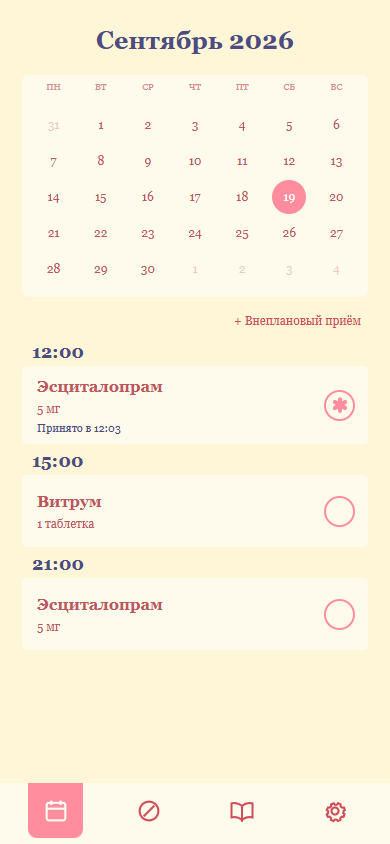
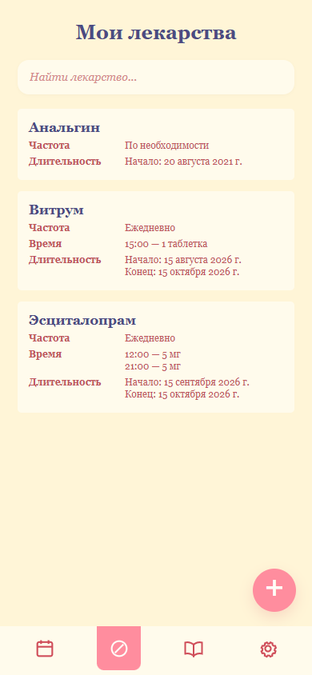
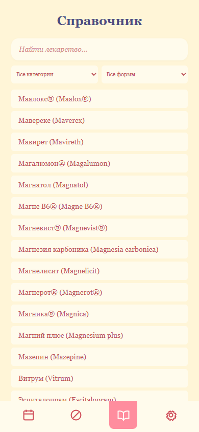
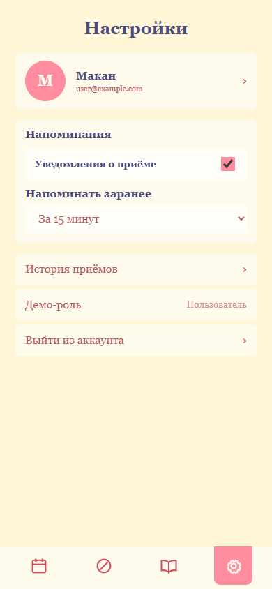

# Моя аптечка

Веб-приложение для ведения курсов лекарств, расписания и истории приёмов. Пользователь входит по коду из письма, работает со справочником препаратов и может отмечать как запланированные, так и внеплановые приёмы. Медицинские данные шифруются на устройстве до отправки на сервер.

## Возможности

- несколько времён и разные дни приёма внутри одного курса;
- календарь приёмов и история с фильтрами;
- внеплановый приём из курса, справочника или со своим названием;
- поиск и фильтрация лекарств в справочнике;
- вход по одноразовому коду и обновление сессии;
- локальные напоминания и клиентское шифрование медицинских данных.

## Скриншоты

<table>
  <tr>
    <th>Календарь</th>
    <th>Мои лекарства</th>
    <th>Справочник</th>
    <th>Настройки</th>
  </tr>
  <tr>
    <td></td>
    <td></td>
    <td></td>
    <td></td>
  </tr>
</table>

## Технологии

- frontend: Vue 3, Vite;
- backend: FastAPI, SQLAlchemy;
- база данных: PostgreSQL.

## Подготовка backend

Нужны Python 3.13 и PostgreSQL. Создайте пустую базу данных, затем выполните:

```powershell
cd server
py -3.13 -m venv .venv
.\.venv\Scripts\Activate.ps1
python -m pip install -r requirements.txt
Copy-Item .env.example .env
```

В `server/.env` укажите подключение к PostgreSQL, секрет приложения и данные SMTP для отправки кодов. Название созданной базы должно совпадать с `DB_NAME`.

Таблицы и начальные записи справочника создаются автоматически при запуске backend. Автосоздание не изменяет старую структуру уже существующих таблиц, поэтому после изменения моделей учебную базу нужно пересоздать. Таблицы также можно создать отдельно:

```powershell
python -m app.db.create_tables
```

## Подготовка frontend

Нужны Node.js и npm. Перед первым запуском выполните:

```powershell
cd frontend
npm install
Copy-Item .env.example .env
```

В `frontend/.env` задаётся адрес backend без `/api/v1`:

```env
VITE_API_URL=http://127.0.0.1:8000
```

Для опубликованного frontend здесь должен быть публичный HTTPS-адрес backend. Переменная подставляется во время сборки, поэтому после её изменения frontend нужно перезапустить или собрать заново.

## Запуск

Backend запускается из папки `server` с активированным виртуальным окружением:

```powershell
python -m uvicorn app.main:app --reload
```

Frontend запускается в отдельном терминале из папки `frontend`:

```powershell
npm run dev
```

- приложение: <http://127.0.0.1:5173>
- API: <http://127.0.0.1:8000>
- документация API: <http://127.0.0.1:8000/docs>

## Проверка

```powershell
cd server
python -m pytest

cd ..\frontend
npm run build
```

## Документация

- [Подробный запуск backend](server/README.md)
- [Правила предметной области](docs/domain-rules.md)
- [Структура базы данных](docs/database-design.md)
- [Шифрование медицинских данных](docs/encryption.md)
- [Описание API](server/docs/api.md)

